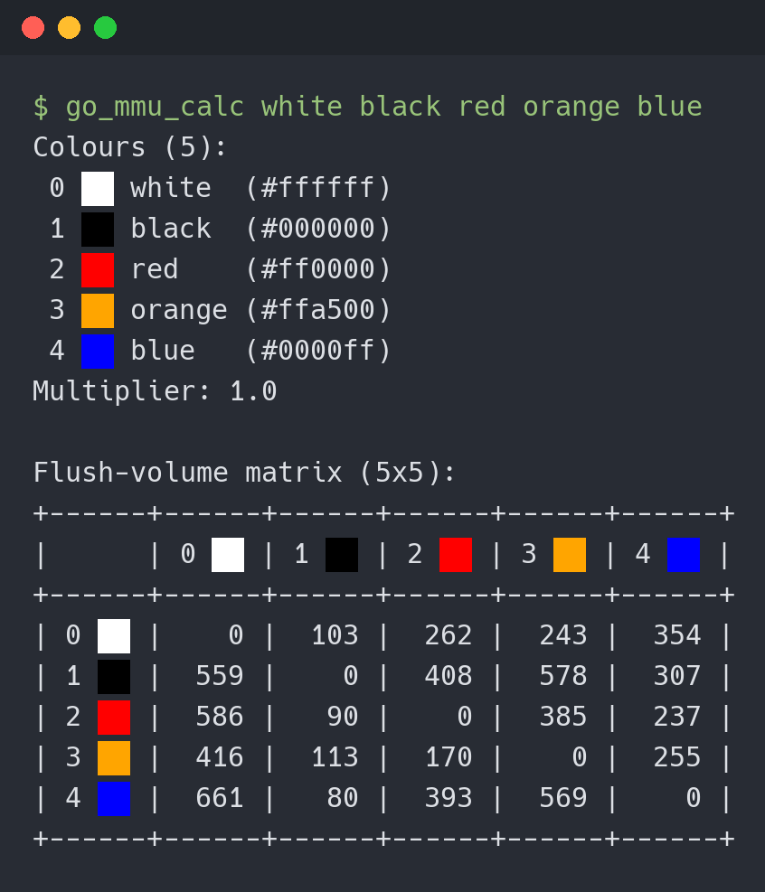

# go_mmu_calc

A small command-line tool that calculates **flush (purge) volumes** for multi-material
3D printing (MMU / AMS-style setups). Give it a list of filament colours and it prints
the full matrix of flush volumes needed when switching from one colour to another.

The calculation replicates the colour-based flush volume algorithm used by
[OrcaSlicer](https://github.com/SoftFever/OrcaSlicer). It's handy when your slicer
doesn't calculate flush volumes automatically, or whenever you want to work them
out yourself, and the results can be entered into any slicer's flushing volume table.

<p align="center">
  
</p>

## Features

- Pairwise flush-volume matrix for up to 10 filaments
- Colours by name (`red`, `navy`, `darkorange`, …) or hex (`#f80`, `#ff8800`, `#ff8800ff`)
- Adjustable flush multiplier
- Coloured swatches in the terminal (24-bit colour), with a `--no-color` fallback
- Interactive mode when no colours are given
- No dependencies outside the Go standard library

## Installation

Requires Go 1.21 or newer.

```sh
go install github.com/mich-w/go_mmu_calc@latest
```

Or build from source:

```sh
git clone https://github.com/mich-w/go_mmu_calc.git
cd go_mmu_calc
go build
```

## Usage

```
go_mmu_calc [OPTIONS] [COLOURS...]
```

| Option                     | Description                                    |
| -------------------------- | ---------------------------------------------- |
| `-l`, `--list-colors`      | List all available colour names (alphabetical) |
| `-lh`, `--list-colors-hue` | List all available colour names (by hue)       |
| `-m`, `--multiplier FLOAT` | Flush volume multiplier (default: `1.0`)       |
| `--no-color`               | Disable coloured terminal output               |
| `-h`, `--help`             | Show help                                      |

If no colours are passed, the tool asks for the number of filaments, each colour,
and the multiplier interactively.

### Examples

```sh
go_mmu_calc white black red orange blue
go_mmu_calc "#ff0000" "#00f" -m 1.5
go_mmu_calc -lh
```

Example output (`go_mmu_calc --no-color white black red orange blue`):

```
Colours (5):
 0  white  (#ffffff)
 1  black  (#000000)
 2  red    (#ff0000)
 3  orange (#ffa500)
 4  blue   (#0000ff)
Multiplier: 1.0

Flush-volume matrix (5x5):
+------+------+------+------+------+------+
|      | 0    | 1    | 2    | 3    | 4    |
+------+------+------+------+------+------+
| 0    |    0 |  103 |  262 |  243 |  354 |
| 1    |  559 |    0 |  408 |  578 |  307 |
| 2    |  586 |   90 |    0 |  385 |  237 |
| 3    |  416 |  113 |  170 |    0 |  255 |
| 4    |  661 |   80 |  393 |  569 |    0 |
+------+------+------+------+------+------+
```

Rows are the colour being flushed **from**, columns the colour being switched **to**,
and values are in mm³. Results are clamped to the range 60–20000.

## How it works

For each pair of colours the tool:

1. Converts both colours to HSV and measures their hue/saturation distance.
2. Compares their luminance — going from dark to light needs much more flushing
   than going from light to dark.
3. Combines both factors, adds an extra 30% when switching from a light colour to
   a very dark one, and applies the multiplier.

## Running tests

```sh
go test ./...
```

## License

[MIT](LICENSE)
